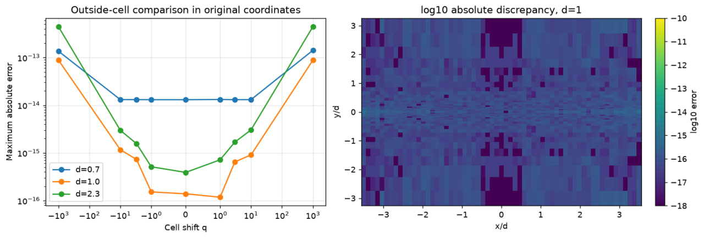

## Riemann solvers for shallow-water simulations

**Project: RDycore**  
**Advisor: Prof. Jed Brown**

I work on the implementation and evaluation of approximate
Riemann solvers in RDycore, an open-source finite-volume code
for shallow-water and compound flooding simulations.

My work compares Roe, HLL, and HLLC solvers in terms of
accuracy, numerical diffusion, and computational cost.
The benchmarks include square dam-break problems,
flow over complex topography, and a Houston flooding case.

In the cases presented in my slides, HLLC produces solutions
close to Roe while achieving a computational cost close to HLL.
I also examine how mesh refinement affects the solution
relative to the choice of Riemann solver.

### Presentation

*Comparison of Roe, HLL, and HLLC Riemann Solvers in RDycore:
Accuracy, Diffusion, and GPU Considerations for Shallow-Water
Simulations*

41st Colorado Conference on Iterative and Multigrid Methods, 2026.

[View presentation slides](/files/riemann-solvers.pdf)

---

## Quasiperiodic Green’s functions for the Helmholtz equation

**Status: Work in progress**

I’m developing a Python implementation for evaluating
quasiperiodic Green’s functions for the two-dimensional
Helmholtz equation, building on formulations by Agocs and Barnett.

The implementation combines direct evaluation of nearby
sources with a lattice-sum representation of the remaining
contributions.

My current notebook explores:

- Convergence and comparisons with reference evaluations.
- Quasiperiodic translations outside the central cell.
- Recovery of the free-space Green’s function through
  inverse Floquet–Bloch integration.
- Extensions to doubly quasiperiodic Green’s functions.
- First spatial derivatives and finite-difference checks.

This work is ongoing, with an emphasis on numerical accuracy,
consistent phase conventions, and independent verification.

### Numerical results

The following figures show selected numerical checks from
my ongoing implementation.

#### Convergence against a spectral reference

The absolute discrepancy decreases as the quadrature and
series parameters are refined, reaching approximately
machine precision in the example shown. The panels vary
the number of quadrature nodes, the integration cutoff,
and the number of expansion terms.

#### Evaluation outside the central cell

These tests examine evaluation beyond the central cell.
The left panel shows the maximum absolute error for
different cell shifts and periods. The right panel maps
the logarithm of the absolute discrepancy over the
tested spatial grid.

#### Reconstructing the free-space Green’s function

Inverse Floquet–Bloch integration recovers the free-space
Green’s function at the tested target points. The left
panel shows the reconstruction error as the quadrature
is refined. The right panel shows the real and imaginary
parts of the contour integrand, including its Jacobian.
