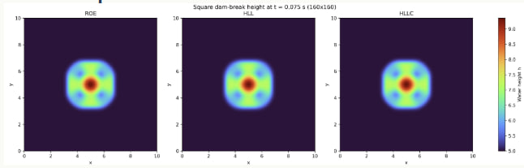
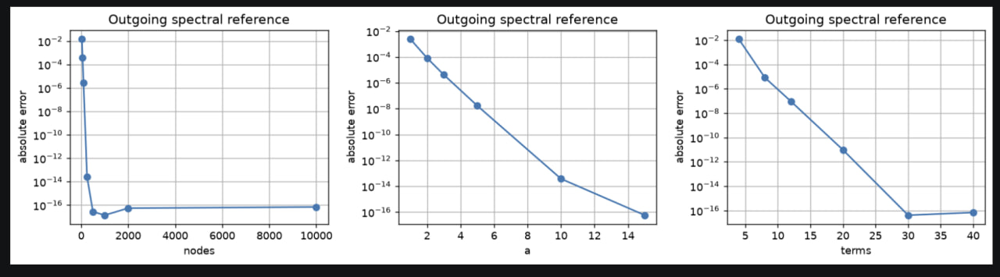
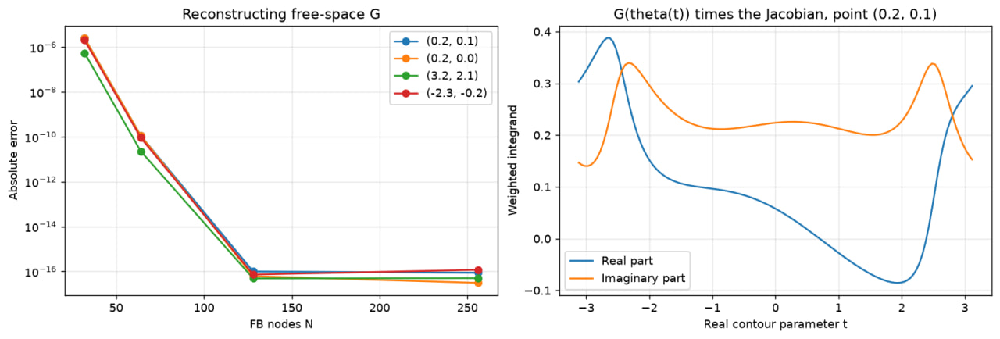

My research focuses on numerical methods for partial differential
equations, with current projects in shallow-water simulation
and Helmholtz Green’s functions.

## Riemann solvers for shallow-water simulations

**Working with Prof. Jed Brown**

Riemann solvers determine the numerical fluxes between cells in
finite-volume simulations. Their choice affects how accurately
a simulation captures waves and how much computation it requires.

I work on implementing and evaluating HLL and HLLC solvers in
RDycore, an open-source code for shallow-water and compound
flooding simulations, and comparing them with the Roe solver.

My tests include square dam-break problems, flow over the
Four Mounds topography, and a Houston flooding case.
I examine numerical diffusion, mesh refinement, and runtime.

In the benchmarks presented in my slides, HLLC produces solutions
close to Roe at a computational cost close to HLL. The comparisons
also show how mesh resolution influences the differences between
the computed solutions.

Comparison at a fixed mesh resolution for the square dam-break
benchmark. In this example, Roe and HLLC produce similar wave
structures, while HLL introduces more numerical diffusion.

[Presentation slides](/files/riemann-solvers.pdf)
· [Conference presentation, June 2026](/talks/2026-06-riemann-solvers/)

---

## Quasiperiodic Green’s functions for the Helmholtz equation

**Working with Prof. Fruzsina Agocs**  
**Ongoing research**

Quasiperiodic Green’s functions describe wave fields generated
by repeated sources with a prescribed phase shift between cells.
Accurate evaluation of these functions is useful for numerical
methods for wave propagation and scattering in periodic structures.

I’m developing a Python implementation for the two-dimensional
Helmholtz equation, building on formulations by Agocs and Barnett.
The method evaluates nearby sources directly and represents
the remaining contributions through lattice coefficients.

My current work includes convergence tests, evaluation outside
the central cell, and inverse Floquet–Bloch integration to recover
the free-space Green’s function. I’m also exploring doubly
quasiperiodic formulations and checks of first spatial derivatives.

### Selected numerical results

These figures show checks for selected test configurations.
Click a figure to view it at full size.

#### Convergence against a spectral reference

The three panels vary the number of quadrature nodes, the
integration cutoff, and the number of expansion terms.
For this test, the absolute discrepancy with the spectral
reference decreases to approximately machine precision.

#### Evaluation outside the central cell

The left panel shows the maximum absolute error for different
cell shifts and periods. The right panel maps the logarithm
of the absolute discrepancy over the tested spatial grid,
including points outside the central cell.

#### Recovering the free-space Green’s function

The left panel shows the reconstruction error at four target
points as the Floquet–Bloch quadrature is refined.
The right panel shows the real and imaginary parts of the
contour integrand, including its Jacobian, for one target point.
